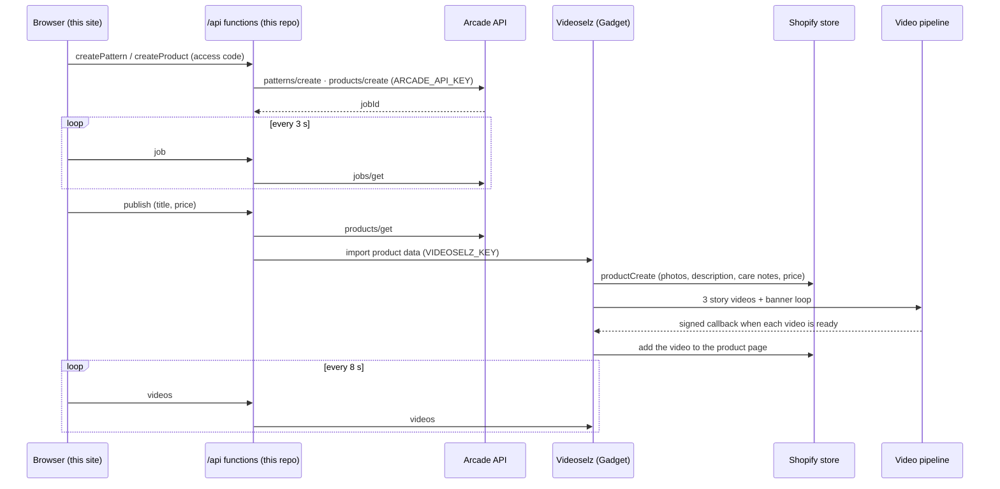
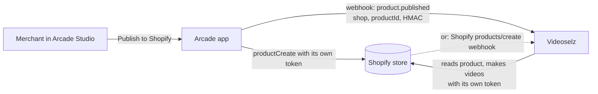

# Arcade × Videoselz

Describe a design and get a real product with its videos.

1. **Arcade** turns your description into a pattern and the pattern into a
   made-to-order product: fabric, size, mockup photos and a unit price.
2. **Videoselz** puts the product on a Shopify store. It then makes 3 short
   story videos and a banner loop, and adds them to the product page.

This repo is the whole Arcade side: a React page plus two small server
functions that call the Arcade API, poll its jobs and keep the API key off the
browser. Videoselz (a Shopify app built on Gadget) only takes the finished
product, lists it on Shopify and makes the videos.

## Try it

1. Open the live site and enter the access code at the top (email
   yash@videoselz.com for one), then click **Unlock**.
2. **Describe your design** and click **Generate pattern**. Arcade draws it in
   about a minute. Tweak it if you like.
3. **Choose the product**: pick a type on the left (for example Decorative
   Pillows), set its options on the right and click **Create**. Arcade builds
   the product and its photos.
4. **Sell it with videos**: set a title and price and click **Send to
   Videoselz**. The 4 videos (3 stories and a banner loop) appear on the page
   and fill in as they finish. That takes several minutes.

## See it in Shopify

Clicking **Send to Videoselz** creates a real product on the Videoselz demo
store (`joey-selz.myshopify.com`). Here is where to find each piece.

### On this site (anyone)

The 4 video tiles under step 3 play the finished videos. **Open ↗** opens a
video on its own.

### In the Shopify admin (store staff)

You need a staff login on the demo store; ask yash@videoselz.com for one.

| What | Where |
| --- | --- |
| The product | **Products** → the title you chose. It is tagged `arcade` and `ai-video`, its vendor is the Arcade maker, and it has Arcade's photos, description, care instructions and your price. |
| The videos | **Apps → Videoselz** (the dev build is listed as *realityshop-test*) **→ Library**: the 3 story videos and the banner loop, added to the product's video page automatically. |
| The Arcade product in Videoselz | **Apps → Videoselz → Design with Arcade → Your Arcade products**. |

### On the storefront (shoppers)

1. **Put the product on the Online Store (one click, once per product).**
   Videoselz creates the product as Active, but it doesn't add it to sales
   channels: that would need Shopify's `write_publications` permission. In the
   admin, open the product, find **Publishing** (Sales channels) → **Manage**,
   tick **Online Store** and save.
2. **Open the product page.** On the product, click **View** (the eye icon) or
   go to `https://joey-selz.myshopify.com/products/<product-handle>`. The
   Videoselz widget shows the story videos on the page.
3. **The demo store is password protected.** Find the password under
   **Online Store → Preferences → Password protection**, or ask
   yash@videoselz.com.
4. **Banner loop (optional).** In Videoselz, open the loop and click **Use in
   banner**. Then in **Online Store → Themes → Customize**, add the
   **Videoselz Banner** section and pick that video.

## How it uses the Arcade API

| Step on the page | Arcade API call |
| --- | --- |
| Load the product types | `categories/list` |
| Describe your design → Generate pattern | `patterns/create` (prompt + optional colours) |
| Tweak it | `patterns/refine/edit` |
| Wait for a pattern or product | `jobs/get` (polled every 3 s) |
| Choose the product and its options | `categories/get` (only options that can be made, plus `canManufacture`) |
| Create the product | `products/create` |
| Send to Videoselz | `products/get` (title, photos, description, care instructions, maker, unit price) |

All of these run in [`server/arcade.js`](server/arcade.js). Open **Behind the
scenes** on the page to see each call as it happens.

## Flow

```
Browser ──► /api/arcade  (this repo, holds ARCADE_API_KEY) ──► Arcade API
              patterns · categories · products · jobs/get polling

Browser ──► /api/videoselz (this repo) ──► Videoselz on Gadget (VIDEOSELZ_KEY)
              publish: product data from Arcade   ├─ creates the Shopify product
              videos:  polled every 8 s           └─ makes 3 story videos + a banner loop
```

| Path | What it does |
| --- | --- |
| `src/` | The page (React + Vite) |
| `api/arcade.js` | Server function: Arcade calls and job polling |
| `api/videoselz.js` | Server function: sends the finished product to Videoselz, reads its videos |
| `server/arcade.js` | Arcade API client (auth, retries, idempotent `requestId`s) |
| `server/handlers.js` | Access code check and the operations behind both functions |

## Architecture

### This demo



The Arcade key stays in this repo's server functions. The Shopify token and the
video pipeline stay in Videoselz. The browser only talks to `/api/*`.

### In production: Arcade and Videoselz installed on the same store

Here a merchant has both apps installed on their Shopify store. Each app
already holds its own Shopify access token for that store, so neither app
needs the other's credentials. The only thing that has to cross between them is
**"this product is ready"**.



Two ways to get that signal, both without sharing tokens:

1. **Arcade → Videoselz webhook (recommended).** When the merchant publishes
   with "Product videos" switched on, Arcade calls a Videoselz URL. The URL
   takes `{ event: "product.published", shop: "store.myshopify.com",
   shopifyProductId, arcadeProductId }`, signed with HMAC-SHA256 over a shared
   secret. Videoselz:
   - checks the signature;
   - looks up the shop among its installs, so a store without Videoselz is
     ignored;
   - makes the videos with its own offline token.

   This is how the Videoselz video pipeline already reports back: a signed
   callback with a timestamp, retried until it is accepted.
2. **Shopify webhook only, no Arcade change.** Videoselz already subscribes to
   `products/create` for its installs. It can make videos automatically for
   new products from Arcade, which it recognises by vendor, tag or metafield.
   This needs no work from Arcade, but the merchant can't turn videos on or
   off per product in Arcade Studio.

Either way the merchant sees the videos in the Videoselz app and on the product
page, and nothing changes in how either app authenticates with Shopify.

### Status

| Piece | State |
| --- | --- |
| Arcade API: patterns, refine, categories, products, jobs | Working |
| Product on Shopify with Arcade photos, description, care notes and price | Working |
| 3 story videos + banner loop on the product page | Working |
| This site: Arcade calls in `/api`, Videoselz import | Working locally; set the env vars on Vercel to go live |
| Arcade → Videoselz webhook | Designed (above), needs an endpoint on Arcade's side |

## Run it locally

```bash
npm install
cp .env.example .env
npm run dev
```

Fill in `.env` (server-only, never sent to the browser or committed):

| Variable | What it is |
| --- | --- |
| `ARCADE_API_KEY` | Your Arcade API key (`arcade_sk_live_…`) |
| `ARCADE_CONTACT` | Contact email for the User-Agent Arcade requires |
| `ACCESS_CODE` | Code visitors type before anything that costs money (optional) |
| `VIDEOSELZ_URL` | The Videoselz import endpoint |
| `VIDEOSELZ_KEY` | Shared key for that endpoint. **Email yash@realityshop.com for it.** |

`npm run dev` serves the page and the `/api` functions together.

## Deploy

**Vercel** (recommended): import this repo. It detects Vite and deploys
`api/*.js` as serverless functions. Add the five variables above under
**Settings → Environment Variables**, then redeploy.

## FAQ

**"Can't reach Videoselz."**
Wait a few seconds and reload. If it keeps happening, email
yash@videoselz.com.

**"That access code isn't right."**
Generating patterns, products and videos costs money, so those steps need the
code from the Videoselz team.

**"Videoselz has made today's demo products."**
There is a daily limit on products sent to Videoselz. Try again tomorrow, or
email us.

**The pattern or product takes a while.**
Arcade takes about 1–2 minutes for each. The progress bar is an estimate.

**The videos take a while.**
Each video is planned, generated, narrated and rendered. Expect several minutes.
The tiles update on their own.

**Where are the keys?**
In environment variables on the server: `.env` locally, which is gitignored,
and the Vercel project settings in production. The browser only ever talks to
`/api/*`.
