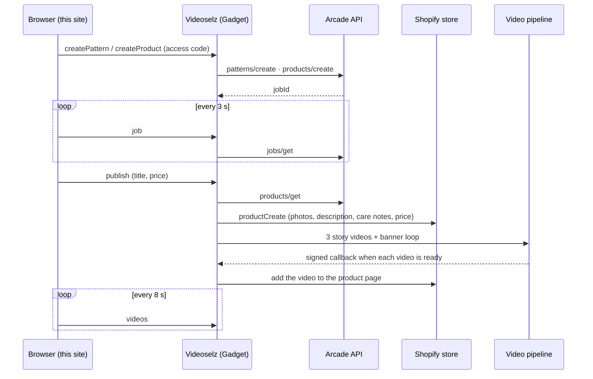
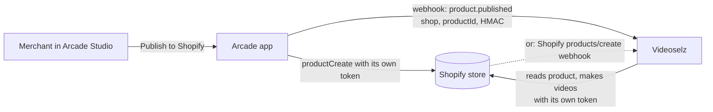

# Arcade × Videoselz

Describe a design and get a real product with its videos.

1. **Arcade** turns your description into a pattern and the pattern into a
   made-to-order product: fabric, size, mockup photos and a unit price.
2. **Videoselz** puts the product on a Shopify store. It then makes 3 short
   story videos and a banner loop, and adds them to the product page.

This repo is the website. It is a React app with no backend of its own. Every
request goes to one Videoselz endpoint, and Videoselz holds the Arcade API key.

## How it uses the Arcade API

| Step on the page | Arcade API call |
| --- | --- |
| Load the product types | `categories/list` |
| Describe your design → Generate pattern | `patterns/create` (prompt + optional colours) |
| Tweak it | `patterns/refine/edit` |
| Wait for a pattern or product | `jobs/get` (polled every 3 s) |
| Choose the product and its options | `categories/get` (only options that can be made, plus `canManufacture`) |
| Create the product | `products/create` |
| Send to Videoselz | `products/get` (title, photos, description, care instructions, maker, unit price) |

Open **Behind the scenes** at the bottom of the page to see each call as it
happens.

## Flow

```
Browser ── POST /arcade-public/studio ──► Videoselz (Gadget) ──► Arcade API
                                              │
                                              ├─ creates the Shopify product
                                              └─ makes 3 story videos + a banner loop
Browser ◄── polls { op: "videos" } ───────────┘
```

## Architecture

### This demo



The Arcade key, the Shopify token and the video pipeline all stay on the
Videoselz side. The site only knows one public URL.

### In production: Arcade and Videoselz installed on the same store

Here a merchant has both apps installed on their Shopify store. Each app
already holds its own Shopify access token for that store, so neither app
needs the other's credentials. The only thing that has to cross between them is
**"this product is ready"**.



Two ways to get that signal, both without sharing tokens:

1. **Arcade → Videoselz webhook (recommended).** When the merchant publishes
   with "Product videos" switched on, Arcade calls a Videoselz URL. The URL
   takes `{ event: "product.published", shop: "store.myshopify.com",
   shopifyProductId, arcadeProductId }`, signed with HMAC-SHA256 over a shared
   secret. Videoselz:
   - checks the signature;
   - looks up the shop among its installs, so a store without Videoselz is
     ignored;
   - makes the videos with its own offline token.

   This is how the Videoselz video pipeline already reports back: a signed
   callback with a timestamp, retried until it is accepted.
2. **Shopify webhook only, no Arcade change.** Videoselz already subscribes to
   `products/create` for its installs. It can make videos automatically for
   new products from Arcade, which it recognises by vendor, tag or metafield.
   This needs no work from Arcade, but the merchant can't turn videos on or
   off per product in Arcade Studio.

Either way the merchant sees the videos in the Videoselz app and on the product
page, and nothing changes in how either app authenticates with Shopify.

### Status

| Piece | State |
| --- | --- |
| Arcade API: patterns, refine, categories, products, jobs | Working |
| Product on Shopify with Arcade photos, description, care notes and price | Working |
| 3 story videos + banner loop on the product page | Working |
| This public site | Working (needs an access code) |
| Arcade → Videoselz webhook | Designed (above), needs an endpoint on Arcade's side |

## Run it locally

```bash
npm install
cp .env.example .env
npm run dev
```

`VITE_VIDEOSELZ_URL` in `.env` is the Videoselz endpoint. It is a public URL,
not a secret. Steps that cost money (patterns, products, videos) may ask for
an access code. **Email yash@videoselz.com to get one.**

## Deploy

The site is static, so it runs on any static host.

- **Vercel**: import this repo. The framework preset is Vite, the build command
  is `npm run build` and the output directory is `dist`. Add
  `VITE_VIDEOSELZ_URL` as an environment variable.
- **Render**: create a Static Site with the same build command and publish
  directory `dist`.

## FAQ

**"Can't reach Videoselz."**
Wait a few seconds and reload. If it keeps happening, email
yash@videoselz.com.

**"That access code isn't right."**
Generating patterns, products and videos costs money, so those steps need the
code from the Videoselz team.

**"Videoselz has made today's demo products."**
There is a daily limit on products sent to Videoselz. Try again tomorrow, or
email us.

**The pattern or product takes a while.**
Arcade takes about 1–2 minutes for each. The progress bar is an estimate.

**The videos take a while.**
Each video is planned, generated, narrated and rendered. Expect several minutes.
The tiles update on their own.

**Where are the keys?**
Not in this repo. The Arcade API key lives only on the Videoselz server. The
site has no secrets; `.env` only holds the public endpoint URL.
