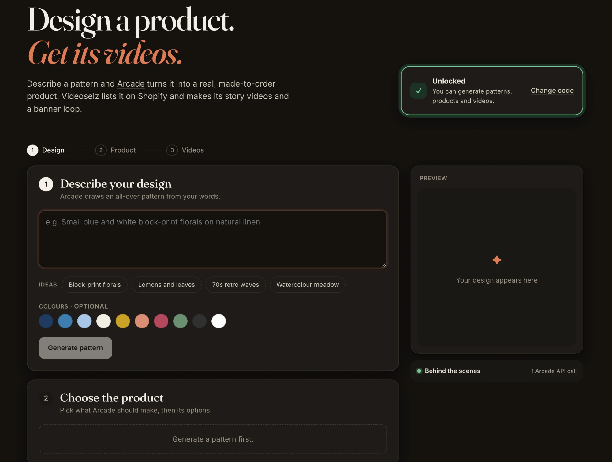
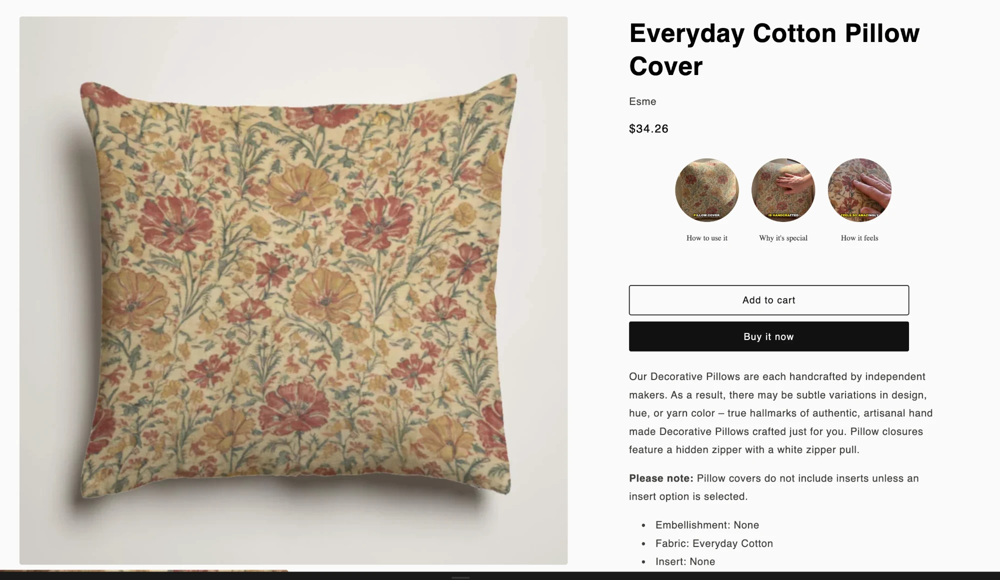
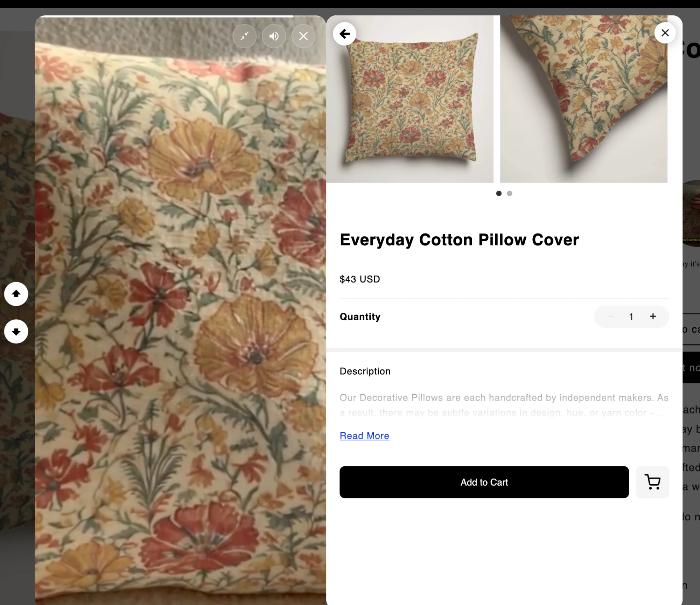
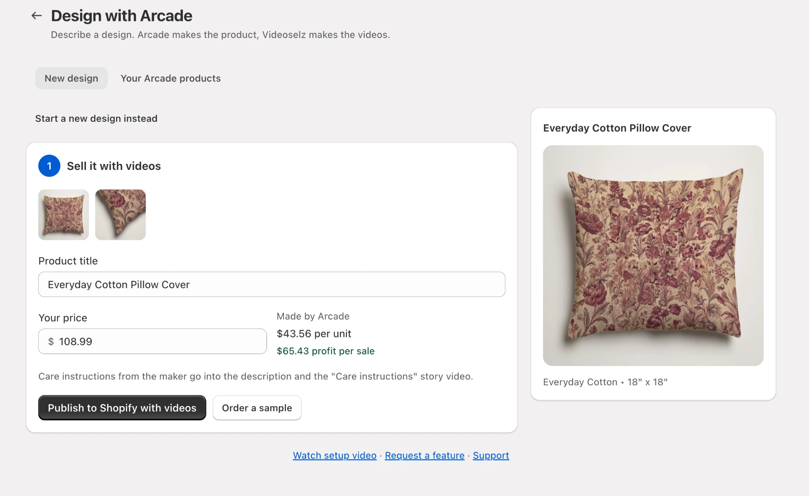
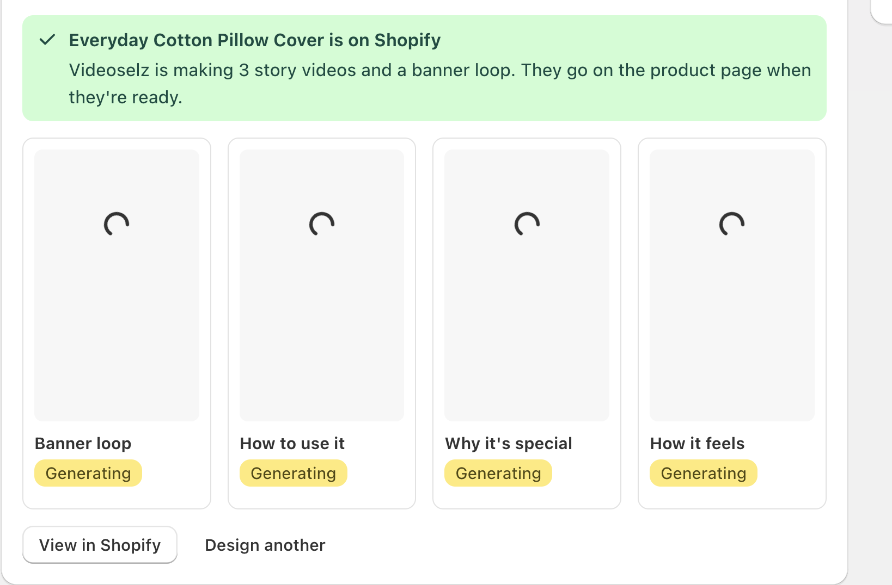
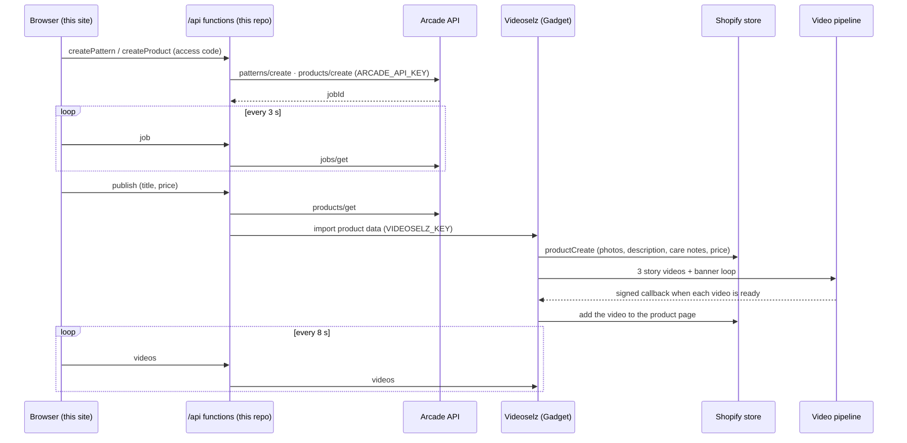
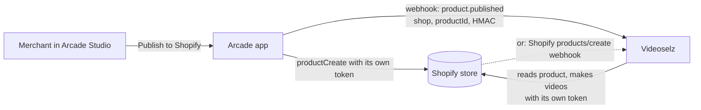

# Arcade × Videoselz

**Describe a design, get a real product on Shopify, with videos that sell it.**

A merchant types a few words, such as *"hand-painted wildflower meadow in
terracotta and sage"*. Two products then work together:

- **[Arcade](https://www.arcade.ai)** turns the words into a seamless pattern
  and the pattern into a made-to-order product: fabric, size, mockup photos,
  care instructions and a unit cost.
- **Videoselz**, a Shopify app, makes the videos that sell it: 3 short story
  videos in a phone-friendly 9:16 shape and a looping banner. The product goes
  live on the merchant's Shopify store with those videos playing on its product
  page.

No photo shoot and no video shoot: the merchant goes from an idea to a product
page with video in a few minutes.

> **Demo access code: `12345`.** Generating uses real Arcade credits, so the
> site asks for it before anything that costs money.



---

## How the two connect

```
 ┌──────────────────────── this repo ─────────────────────────┐
 │                                                            │
 │  Browser (React)  ──►  /api/arcade  ──────────────►  Arcade API
 │                         holds ARCADE_API_KEY          patterns, products,
 │                         polls jobs/get                jobs, categories
 │                                                            │
 │                   ──►  /api/videoselz ─┐                   │
 └────────────────────────────────────────┼───────────────────┘
                                          │  finished product data
                                          │  (VIDEOSELZ_KEY)
                                          ▼
                              Videoselz (Shopify app, Gadget)
                              ├─ creates the Shopify product
                              └─ makes 3 story videos + a banner loop
                                          │
                                          ▼
                              Shopify store: product page with the videos
```

1. **The site calls Arcade itself.** Everything Arcade does goes through this
   repo's server functions, which keep the API key off the browser:
   generating and tweaking the pattern, listing the products that can be
   made, creating the product, and polling each job until it's done.
2. **Arcade hands back a finished product:** title, mockup photos,
   description, care instructions, maker and unit cost.
3. **The site hands that product to Videoselz.** It's one server-to-server
   call, protected by a shared key. Videoselz never needs the Arcade key.
4. **Videoselz creates the product on Shopify:** Arcade's photos, the
   description with care instructions, the maker as vendor, and the
   merchant's price.
5. **Videoselz makes the videos.** It plans each story from the product
   photos and care notes, generates the clips, adds a voiceover and captions,
   and renders them. Each finished video goes on the product page by itself.
6. **The site shows the videos as they finish,** and so does the product page
   on the store.

---

## What the shopper sees

The product page on the Shopify store. It has Arcade's photo, the maker
(*Esme*), the merchant's price and Arcade's description. Under the price,
Videoselz shows the 3 story videos as bubbles: **How to use it**, **Why it's
special** and **How it feels**.



Tapping a bubble plays the story full screen, next to a shoppable panel. The
shopper can watch, swipe to the next story, and **Add to Cart** without leaving
the video.



---

## What the merchant sees

The same flow also lives inside Videoselz, in the Shopify admin (**Apps →
Videoselz → Design with Arcade**). Merchants who already use Videoselz can
design with Arcade without leaving their store.

Once Arcade has built the product, the merchant sets the title and price. They
see Arcade's cost per unit and their profit per sale, then click **Publish to
Shopify with videos**.



The product is on Shopify straight away, and the 4 videos appear as they're
made: the banner loop and the 3 stories. Each one goes on the product page when
it's ready.



---

## Try it

1. Open the live site, enter the access code **`12345`** at the top and click
   **Unlock**.
2. **Describe your design** (or pick one of the ideas) and click **Generate
   pattern**. Arcade draws it in about a minute. Use **Tweak it** to adjust
   it.
3. **Choose the product.** Pick a type on the left, for example Decorative
   Pillows. Its options (fabric, size, insert…) open on the right, and only
   combinations Arcade can really make are offered. Click **Create**. Arcade
   builds the product and its photos.
4. **Sell it with videos.** Set a title and price; the page shows Arcade's
   cost and your profit. Click **Send to Videoselz**. The 4 video tiles appear
   and fill in as each video finishes, which takes several minutes.

Open **Behind the scenes** on the page to watch each Arcade API call as it
happens.

## See it in Shopify

**Send to Videoselz** creates a real product on the Videoselz demo store
(`joey-selz.myshopify.com`). Here's where to find each piece.

**On the site (anyone):** the video tiles under step 3 play the finished
videos. **Open ↗** opens one on its own.

**In the Shopify admin (store staff; ask yash@videoselz.com for a login):**

| What | Where |
| --- | --- |
| The product | **Products** → the title you chose. It's tagged `arcade` and `ai-video`, its vendor is the Arcade maker, and it has Arcade's photos, description, care instructions and your price. |
| The videos | **Apps → Videoselz** (the dev build is listed as *realityshop-test*) **→ Library**: the 3 story videos and the banner loop, added to the product's video page automatically. |
| The Arcade products | **Apps → Videoselz → Design with Arcade → Your Arcade products**. |

**On the storefront (shoppers):**

1. **Put the product on the Online Store (one click, once per product).**
   Videoselz creates the product as Active but doesn't add it to sales
   channels, because that would need Shopify's `write_publications`
   permission. In the admin, open the product, go to **Publishing** (Sales
   channels) → **Manage**, tick **Online Store** and save.
2. **Open the product page.** Click **View** (the eye icon) on the product, or
   go to `https://joey-selz.myshopify.com/products/<product-handle>`. The story
   videos sit under the price, as in the screenshot above.
3. **The demo store is password protected.** Find the password under
   **Online Store → Preferences → Password protection**, or ask
   yash@videoselz.com.
4. **Banner loop (optional).** In Videoselz, click **Use in banner** on the
   loop. Then in **Online Store → Themes → Customize**, add the **Videoselz
   Banner** section and pick that video.

## How it uses the Arcade API

| Step on the page | Arcade API call |
| --- | --- |
| Load the product types | `categories/list` |
| Describe your design → Generate pattern | `patterns/create` (prompt + optional colours) |
| Tweak it | `patterns/refine/edit` |
| Wait for a pattern or product | `jobs/get` (polled every 3 s) |
| Choose the product and its options | `categories/get` (only options that can be made, plus `canManufacture`) |
| Create the product | `products/create` |
| Send to Videoselz | `products/get` (title, photos, description, care instructions, maker, unit price) |

All of these run in [`server/arcade.js`](server/arcade.js). Open **Behind the
scenes** on the page to see each call as it happens.

## Flow

```
Browser ──► /api/arcade  (this repo, holds ARCADE_API_KEY) ──► Arcade API
              patterns · categories · products · jobs/get polling

Browser ──► /api/videoselz (this repo) ──► Videoselz on Gadget (VIDEOSELZ_KEY)
              publish: product data from Arcade   ├─ creates the Shopify product
              videos:  polled every 8 s           └─ makes 3 story videos + a banner loop
```

| Path | What it does |
| --- | --- |
| `src/` | The page (React + Vite) |
| `api/arcade.js` | Server function: Arcade calls and job polling |
| `api/videoselz.js` | Server function: sends the finished product to Videoselz, reads its videos |
| `server/arcade.js` | Arcade API client (auth, retries, idempotent `requestId`s) |
| `server/handlers.js` | Access code check and the operations behind both functions |

## Architecture

### This demo



The Arcade key stays in this repo's server functions. The Shopify token and the
video pipeline stay in Videoselz. The browser only talks to `/api/*`.

### In production: Arcade and Videoselz installed on the same store

Here a merchant has both apps installed on their Shopify store. Each app
already holds its own Shopify access token for that store, so neither app
needs the other's credentials. The only thing that has to cross between them is
**"this product is ready"**.



Two ways to get that signal, both without sharing tokens:

1. **Arcade → Videoselz webhook (recommended).** When the merchant publishes
   with "Product videos" switched on, Arcade calls a Videoselz URL. The URL
   takes `{ event: "product.published", shop: "store.myshopify.com",
   shopifyProductId, arcadeProductId }`, signed with HMAC-SHA256 over a shared
   secret. Videoselz:
   - checks the signature;
   - looks up the shop among its installs, so a store without Videoselz is
     ignored;
   - makes the videos with its own offline token.

   This is how the Videoselz video pipeline already reports back: a signed
   callback with a timestamp, retried until it is accepted.
2. **Shopify webhook only, no Arcade change.** Videoselz already subscribes to
   `products/create` for its installs. It can make videos automatically for
   new products from Arcade, which it recognises by vendor, tag or metafield.
   This needs no work from Arcade, but the merchant can't turn videos on or
   off per product in Arcade Studio.

Either way the merchant sees the videos in the Videoselz app and on the product
page, and nothing changes in how either app authenticates with Shopify.

### Status

| Piece | State |
| --- | --- |
| Arcade API: patterns, refine, categories, products, jobs | Working |
| Product on Shopify with Arcade photos, description, care notes and price | Working |
| 3 story videos + banner loop on the product page | Working |
| This site: Arcade calls in `/api`, Videoselz import | Working locally; set the env vars on Vercel to go live |
| Arcade → Videoselz webhook | Designed (above), needs an endpoint on Arcade's side |

## Run it locally

```bash
npm install
cp .env.example .env
npm run dev
```

Fill in `.env` (server-only, never sent to the browser or committed):

| Variable | What it is |
| --- | --- |
| `ARCADE_API_KEY` | Your Arcade API key (`arcade_sk_live_…`) |
| `ARCADE_CONTACT` | Contact email for the User-Agent Arcade requires |
| `ACCESS_CODE` | Code visitors type before anything that costs money (optional) |
| `VIDEOSELZ_URL` | The Videoselz import endpoint |
| `VIDEOSELZ_KEY` | Shared key for that endpoint. **Email yash@realityshop.com for it.** |

`npm run dev` serves the page and the `/api` functions together.

## Deploy

**Vercel** (recommended): import this repo. It detects Vite and deploys
`api/*.js` as serverless functions. Add the five variables above under
**Settings → Environment Variables**, then redeploy.

## FAQ

**"Can't reach Videoselz."**
Wait a few seconds and reload. If it keeps happening, email
yash@videoselz.com.

**"That access code isn't right."**
Generating patterns, products and videos costs money, so those steps need the
access code. For this demo it is **`12345`**.

**"Videoselz has made today's demo products."**
There is a daily limit on products sent to Videoselz. Try again tomorrow, or
email us.

**The pattern or product takes a while.**
Arcade takes about 1–2 minutes for each. The progress bar is an estimate.

**The videos take a while.**
Each video is planned, generated, narrated and rendered. Expect several minutes.
The tiles update on their own.

**Where are the keys?**
In environment variables on the server: `.env` locally, which is gitignored,
and the Vercel project settings in production. The browser only ever talks to
`/api/*`.
